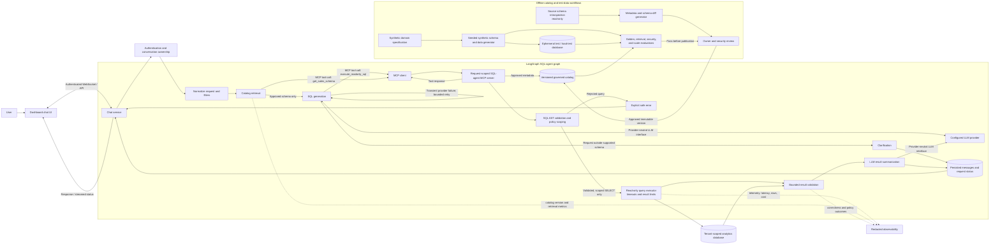

# Scalable SQL Agent Plan

## Goal

Evolve the chat analytics agent from its current fixed-operation classifier into a
maintainable, scalable natural-language analytics system. The agent must continue to
produce answers grounded in the signed-in user's data while supporting more questions,
data sources, tenants, and query volume, including deployments with more than 1,000
available tables.

The SQL-agent runtime may generate SQL with an LLM, but it may execute only a single
validated, read-only query over approved tables and columns. The application injects
authenticated-user and dashboard-filter predicates before execution; the LLM never receives
database credentials or unrestricted database access.

## Current baseline

- `chat/agents/sql_agent/` now contains the LangGraph `StateGraph`: it requests a SQL query,
  validates and scopes it, executes it read-only, then asks the LLM to summarize bounded
  result rows. `agent.py` preserves the existing async `answer()` interface for the chat
  route.
- `chat/services/analytics.py` retains the prior deterministic analytics operations and
  applies authenticated-user and dashboard-filter scope in application-built queries.
- The current generated-SQL executor is deliberately limited to the approved
  `sales_records`, `sites`, and `products` tables until catalog review supports expansion.
- The LLM adapter factory is in `chat/utils/llm_factory/`; supported providers share a
  common request interface.
- Chat persists messages and filter context, and sends answers over an authenticated
  WebSocket.

Preserve these guarantees while making each part easier to extend, test, monitor, and
scale independently.

## Design principles and non-goals

- **Generated SQL, validated before execution:** the model may write a SQL query, but
  application code parses it, restricts it to approved tables/columns/functions, injects
  user and dashboard filters, and enforces result/time bounds before execution.
- **Tenant isolation is non-negotiable:** derive the account scope from the authenticated
  server-side user. Never accept a tenant or account identifier as model-selected scope.
- **Least privilege:** agent tools expose only approved analytics operations and the
  minimum schema descriptions needed for planning.
- **Bounded work:** impose limits on input size, query duration, rows, joins, time range,
  result size, conversation context, and provider output.
- **Grounded answers:** compute result values and final summaries from query results and
  metric definitions. Do not let the model invent or alter returned values.
- **Provider portability:** keep provider-specific behavior inside the existing LLM
  factory. Agent logic depends on provider-neutral typed contracts.
- **Incremental delivery:** add breadth only when representative questions, evaluation
  coverage, and operational safeguards are in place.
- **Catalog scale, not prompt scale:** support thousands of registered tables without
  placing the complete schema or catalog in an LLM prompt.

Not in scope: unrestricted SQL execution, write-capable queries, cross-tenant access,
unbounded schema discovery, general-purpose web search, runtime creation/modification of
production data by the LLM, or letting the LLM choose database credentials or connection
settings.

## Target architecture

The runtime path only generates SQL against a bounded, authorized catalog candidate set.
The model does not receive credentials or execute SQL: application code validates and scopes
the generated query before a read-only executor runs it. Only bounded query results are
provided to the summarization call. Catalog discovery and synthetic data generation are
separate offline workflows: discovered metadata requires review before publication, and
synthetic rows are confined to test/load-test environments.

All SQL-agent schema discovery and query execution go through the request-scoped MCP client
and server. LangGraph nodes do not call SQLAlchemy or the query executor directly. The MCP
server binds authenticated user, database session, and validated dashboard filters for the
request, and exposes only read-only tools. The initial implementation uses the MCP SDK's
in-memory transport within the application process; it does not expose an unauthenticated
remote MCP endpoint.

LangGraph `StateGraph` is the sole SQL-agent orchestration layer. Implement the request
lifecycle as a typed graph with explicit nodes and conditional edges for clarification,
policy rejection, bounded transient retries, execution, and response rendering. Do not add
a parallel custom `SQLAgent` orchestrator or another agent orchestration framework. Graph
nodes may call deterministic, non-database application services, but schema and query
database access must go through the request-scoped MCP client and server. Those services do
not own agent control flow.

Suggested package responsibilities:

- `chat/agents/sql_agent/graph.py`: LangGraph graph definition, node wiring, conditional edges, and
  bounded retry/termination behavior.
- `chat/agents/sql_agent/state.py`: typed graph state and generated-SQL/result contracts.
- `chat/agents/sql_agent/policy.py`: table/column/function allow-lists, SQL limits,
  clarification rules, and authorization checks.
- `chat/agents/sql_agent/catalog.py`: approved metric and dimension definitions, descriptions,
  aggregation rules, and compatible combinations.
- `chat/agents/sql_agent/catalog_search.py`: tenant/source-aware retrieval of a small candidate set
  from the large catalog using deterministic metadata filters and lexical/semantic ranking.
- `chat/services/schema_registry.py`: versioned, generated schema metadata, ownership
  policies, relationships, and catalog freshness state.
- `chat/services/analytics.py`: reusable domain-level analytics operations.
- `chat/agents/sql_agent/query_executor.py`: parses generated SQL, rejects unsafe AST
  shapes, injects user/filter scope, and executes bounded read-only queries; called only by
  the MCP server.
- `chat/agents/sql_agent/mcp_server.py`: request-scoped MCP tools for approved schema
  discovery and guarded read-only SQL execution.
- `chat/agents/sql_agent/graph.py`: generates SQL and summarizes bounded results using the
  provider-neutral LLM interface.
- `chat/agents/sql_agent/schemas.py`: strict generated-query/clarification contract and
  graph-facing errors.
- `chat/services/`: deterministic services called by graph nodes; no agent orchestration.
- `chat/utils/llm_factory/`: provider clients, structured-output support, timeout/cancellation,
  capability declarations, and provider-specific error translation.

Keep the graph small and explicit; introduce subgraphs only when they have an independently
tested state contract. Use LangGraph state/checkpoint persistence only where resumability or
multi-step interactions require it, and scope any checkpoint data to the authenticated
conversation with retention controls.

## Generated SQL contract

The model returns one strict JSON object containing exactly one of:

- `sql`: a single PostgreSQL `SELECT` query using only registered identifiers; or
- `clarification`: a short question when the request is ambiguous or outside the supported
  domain.

The SQL policy layer must parse, not regex-inspect, the query. It rejects multiple
statements, non-`SELECT` operations, CTEs, subqueries, aliases, unapproved schemas/tables/
columns/functions, star projections, unbounded/offset results, and unsupported SQL features.
It resolves every table and column against the current published catalog and validates all
join paths. Unknown JSON fields and malformed output fail closed.

The application—not the model—injects the authenticated user scope and the selected date,
site, and product filters as bound parameters. It also adds required ownership-safe joins and
clamps result rows, result bytes, and statement duration. The generated query must not be
able to weaken or bypass these predicates through `OR`, aliases, or alternative join paths.
Persist the normalized safe query fingerprint and resolved filters, not raw generated SQL
or provider prompts.

## Analytics catalog and SQL policy

Create a server-owned catalog rather than giving the model direct access to the database
schema. The catalog may describe thousands of tables, but a single SQL-generation prompt
must include only the small, authorized subset relevant to the question. Entries should
define:

- stable key and user-facing name;
- description and business definition;
- approved source table/column identifiers and relationships;
- aggregation and null/zero behavior;
- currency/unit behavior;
- supported dimensions and time grains;
- whether it can be compared across sites/currencies;
- a deterministic test fixture and expected calculation.

Dimension entries should define their allowed source, display label, tenant-safe join path,
filterability, and grouping rules. Resolve generated identifiers to catalog entries before
execution; never interpolate an unvalidated model identifier into an application-built query.

The SQL policy/executor should:

1. Receive generated SQL, catalog version, and authenticated request context.
2. Parse a single read-only query and authorize every identifier and join path.
3. Inject tenant scope and ownership constraints on every query path using bound parameters.
4. Apply database statement timeout, result row/byte caps, and cancellation behavior.
5. Return only normalized, bounded rows to the graph's summarization node.
6. Generate stable query/correlation identifiers without logging raw sensitive values.

Begin with current sales facts and dimensions. Add a new data source only after documenting
its ownership model, relationships, metric semantics, indexes, and isolation tests.

## Supporting more than 1,000 tables

Treat a 1,000+ table environment as a schema-discovery and governance problem, not as a
reason to send more schema text to the model or generate unrestricted SQL. The agent may
discover eligible data across a large registry, but execution remains limited to registered,
reviewed query capabilities.

### Table and schema registry

Maintain versioned metadata for each source, schema, table, column, metric, relationship,
and policy. At minimum, table metadata should include:

- stable table ID, source ID, schema/name, description, business domain, tags, owner, and
  lifecycle status;
- tenant/row-level security key and whether the table is approved for agent access;
- columns with stable IDs, names, types, descriptions, sensitivity classification, and
  filter/group permissions;
- approved primary/foreign-key relationships with cardinality and tenant-safe join rules;
- freshness/update timestamp, schema version/hash, and last successful validation;
- approved metrics, dimensions, date columns, supported aggregations, and row/result limits.

Keep source-system introspection separate from the curated semantic catalog. Raw database
metadata is evidence for catalog authors and validators, not automatically queryable model
context. Deny access by default; exclude system, internal, personal, secret, and unreviewed
tables and columns.

### Discovering relevant metadata

- Filter candidates using deterministic policy constraints first: authenticated tenant,
  source connection, approved domains, table status, data classification, and allowed
  operations.
- Retrieve candidates using indexed terms and synonyms over names, descriptions, tags,
  and governed business glossary terms. Add vector retrieval only if offline relevance
  evaluation shows it improves discovery; combine it with exact lexical and policy filters.
- Retrieve in stages: domain/source selection, candidate table retrieval, then relevant
  columns and approved relationships. Do not retrieve or prompt with all 1,000+ table
  definitions.
- Return a small, configurable candidate set (initial target: at most 10 table groups and
  50 columns) with relevance evidence and catalog version. These are planning hints, not
  permission grants.
- Require policy validation after retrieval. The compiler may use only catalog IDs in the
  request's authorized scope, whether or not retrieval ranked them highly.
- If retrieval confidence is low, multiple incompatible domains match, or a required
  relationship/metric is not curated, ask a clarifying question or decline safely.
- Keep catalog lookup latency bounded with indexes, pagination, short-lived caches keyed
  by catalog version and authorization scope, and explicit cache invalidation on metadata
  changes. Do not cache tenant-visible metadata across authorization scopes.

### Safe query planning across schemas

- Represent joins as reviewed catalog relationships. Validate every model-generated join
  against those paths; never infer authorization or relationship safety from matching
  column names alone.
- Set per-request ceilings for tables, joins, dimensions, filters, date range, query cost,
  scanned rows/bytes where supported, result rows, and serialized result size.
- Start with one fact table and a bounded number of approved dimensions per query. Require
  a reviewed semantic model/materialized view for questions that span ungoverned domains.
- Capture the selected catalog entries, policy decision, plan version, and query fingerprint
  for diagnostics without logging sensitive values or exposing schema internals to users.
- Roll out new catalog entries behind approval/state transitions (`discovered`, `review`,
  `approved`, `deprecated`, `blocked`). A schema discovery job must not automatically grant
  agent access when tables or columns appear.

## Data generation and catalog onboarding

The system needs reproducible data to build the catalog, test SQL generation, and load-test
scale. Keep metadata generation and row-data generation distinct:

### Metadata and catalog generation

- Build an operator-run/offline catalog generator that reads database introspection and
  explicit source manifests. It should enumerate schemas, tables, columns, types,
  constraints, and indexes without scanning or exporting table contents by default.
- Normalize identifiers and types, compute schema fingerprints, and emit a versioned
  catalog-import artifact (for example JSON) with source and generation timestamp.
- Generate draft descriptions, domain tags, relationship candidates, and metric candidates
  only as proposals. Require owner review for business meaning, tenant policy,
  sensitivity, join safety, and executable approval.
- Validate that every approved metric/relationship references existing schema objects,
  respects tenant scope, and has a deterministic test case before publishing a catalog
  version.
- Make generation idempotent and diffable. Report additions, removals, type changes,
  ownership/policy changes, and stale entries; never silently overwrite curated definitions.
- Support catalog rebuilds and rollback by catalog version. Record generator version,
  inputs, configuration, and validation results for reproducibility.

### Synthetic and benchmark data generation

- Provide a separate development/CI generator for synthetic schemas and rows; do not
  generate production records or mutate customer databases as part of agent planning.
- Implement the first PostgreSQL benchmark generator as
  `chat/agents/sql_agent/data_generation/seed_postgres.py`. It targets only the isolated
  `sql_agent_bench` schema, requires a separately configured benchmark database URL, and
  supports explicit reset/drop operations scoped to that schema.
- Default to 1,000 uniquely named tables and a reproducible, configurable small row count
  per table; enforce table/row ceilings before opening a database transaction.
- Generate configurable scale profiles, including a 1,000-table baseline and larger
  profiles, with realistic distributions of fact, dimension, lookup, and irrelevant tables.
  Include varied names, types, relationships, tenant keys, currencies, date ranges, nulls,
  skew, sparsity, and high-cardinality columns.
- Seed deterministic synthetic tenants and sales/events with a fixed random seed so expected
  aggregates, date comparisons, authorization boundaries, and citations are reproducible.
- Include decoy and ambiguous tables/columns, unsafe or unapproved tables, cyclic/invalid
  relationship candidates, and schema drift to test retrieval and policy rejection.
- Keep synthetic data clearly marked, generated only in ephemeral test databases or
  dedicated load-test environments, and free of copied production rows or direct
  identifiers.
- Generate query-question pairs and expected structured plans/results from the same
  synthetic domain specification. Keep a hand-reviewed golden set as the quality reference;
  generated tests supplement but do not replace it.
- Measure generation time, catalog indexing time, retrieval precision/recall, planning
  accuracy, query latency, database work, memory, and token cost at increasing table counts.

### Catalog publication workflow

1. Discover schema metadata with read-only credentials and record a source snapshot.
2. Produce a draft catalog artifact and schema-diff report.
3. Validate identifiers, relationships, tenant policies, sensitivity labels, and contracts.
4. Run synthetic functional, security, and scale evaluations for the candidate catalog.
5. Obtain review/approval from the data owner and security owner for newly executable
   tables, columns, metrics, and relationships.
6. Publish an immutable catalog version, atomically switch readers to it, and retain the
   prior version for rollback.
7. Monitor retrieval misses, stale metadata, plan rejection, query cost, and answer
   correctness; revise catalog entries from measured evidence.

## Agent execution flow

The authenticated chat service performs transport-level validation and invokes the
LangGraph graph with a typed, minimal request state. The graph owns this control flow:

1. Normalize the request and resolve authenticated-user scope and selected filters.
2. Load only bounded, sanitized conversation context. Prefer a compact intent summary over
   replaying a long transcript.
3. Retrieve bounded catalog candidates after deterministic authorization/domain filtering
    and provide only relevant approved schemas/relationships to SQL generation.
4. Ask the LLM for one SQL query or a clarification in the strict output contract. Do not
    send credentials, the full database schema, or unrelated account data.
5. Parse and validate generated SQL against the current catalog. Reject unsafe or ambiguous
    queries explicitly; do not silently broaden or rewrite their analytic intent.
6. Inject authenticated-user ownership and dashboard filters as bound predicates, then
    execute through the read-only executor with timeout, row/byte caps, and cancellation.
7. Provide only bounded normalized result rows, the question, and selected filters to the
    summarization node. Treat cell values as untrusted data and require the summary to stay
    grounded in returned results.
8. Persist catalog version, safe filter metadata, query fingerprint, bounded result rows,
    status, and citations needed for conversation history/debugging. Do not persist raw
    generated SQL or hidden provider prompts; apply chat retention/deletion semantics to
    persisted result rows.

Graph retries are bounded and limited to clearly transient provider errors. Do not retry a
query or provider failure in a way that duplicates execution/persistence or changes the
resolved time range. Make retries idempotent using the existing client request ID.

## Scaling and reliability

### Database

- Add or verify indexes based on measured query plans for the supported filters and common
  groupings.
- Use per-request statement timeouts, a read-only database role for analytics where
  deployment setup permits, bounded result sizes, and cancellation when the client
  disconnects.
- Avoid holding database transactions open while waiting on the LLM. Persist a pending
  attempt, commit, call the provider without a long-lived transaction, then open a fresh
  short transaction to store the result. Use a lease/claim or unique request key to prevent
  concurrent retries from executing duplicate work.
- Add caching only for deterministic aggregate results with a complete cache key that
  includes tenant, normalized plan, filters, data freshness/version, and currency. Never
  share cached results between tenants.
- Inspect actual query plans and database metrics before adding indexes, replicas, or
  pre-aggregated tables.

### Provider and concurrency

- Bound concurrent provider requests per process and per account; coordinate limits across
  replicas using the existing shared infrastructure when traffic warrants it.
- Configure provider timeout, maximum output, queue/backpressure behavior, and provider
  circuit-breaking from server configuration.
- Reuse HTTP connection pools and avoid constructing a new provider transport for every
  message.
- Track per-provider/model latency, timeout/error rate, token usage, and estimated cost while
  redacting prompts, credentials, and personal data.
- Use a background job queue only if measured request duration or throughput makes
  synchronous WebSocket work unsuitable. Preserve request IDs, ownership, cancellation, and
  status semantics when introducing one.

### Application and persistence

- Keep WebSocket handlers thin: authenticate, validate protocol, delegate, and stream status.
- Keep conversation/message pagination cursor-based and bounded. Add retention controls,
  deletion semantics, and cleanup of rate-limit/request-attempt records.
- Make request status explicit (`pending`, `completed`, `failed`, `cancelled`) and ensure
  expired work can be recovered safely after a worker crash.
- Store concise query metadata and citation references rather than large redundant payloads.

## Security and privacy gates

- Authenticate every HTTP route and WebSocket handshake using the established session
  mechanism; validate origin and scope every conversation operation to the authenticated
  user.
- Derive tenant scope from the authenticated principal at query execution, never from
  model output or client-supplied tenant claims.
- Enforce ownership of site/product and future dimensions before compilation and again in
  the query predicate.
- Treat the question, conversation text, catalog labels, and provider response as untrusted
  input. The model must not override policy via instructions embedded in user data.
- Keep all provider credentials server-side. Redact secrets and sensitive prompts from
  logs, traces, and error responses.
- Send the minimum information needed to the selected third-party provider. For the
  summarization call, send only bounded normalized result rows and the user's question;
  document provider-side processing/retention and the data disclosure.
- Use a read-only analytics DB role, network egress restrictions, secret rotation, and
  provider budget controls in production.
- Add abuse controls for message size, connection count, request rate, concurrent requests,
  maximum context, and maximum output.

## Evaluation and test strategy

Build a versioned evaluation set from representative and adversarial questions. Include:

- totals, rankings, trends, period comparisons, average order value, date boundaries,
  relative dates, empty periods, and currency behavior;
- synthetic catalogs at 100, 1,000, and 5,000+ tables, with known relevant tables,
  distractors, multiple domains, authorized/unauthorized sources, and governed join paths;
- schema additions, removals, renames, type changes, stale catalog versions, retrieval
  ambiguity, and rollback to a prior published catalog;
- reproducible generated datasets with varied tenant cardinality, data skew, null rates,
  date coverage, and fact/dimension sizes;
- ambiguous questions and questions outside the supported analytics domain;
- malformed/extra-field plans, unsupported metrics/dimensions, SQL-injection-shaped text,
  prompt injection, and model-generated SQL payloads including comments, aliases, nested
  queries, disallowed functions, write statements, and multiple statements;
- cross-user conversation/site/product IDs and omitted or invalid scope;
- large messages, long history, timeouts, provider failures, cancellation, retries, and
  duplicate concurrent request IDs.

Required assertions:

- generated-query responses are schema-valid and only use catalog allow-lists;
- unsafe SQL or arbitrary identifiers are rejected before execution;
- authenticated-user, dashboard filters, and tenant-safe join conditions are injected by
  application code even when absent from or contradicted by model SQL;
- generated SQL is parsed to a single read-only statement and executes under read-only
  credentials, statement timeout, and bounded result limits;
- numeric answer values exactly match query results and known fixtures;
- summaries are based only on the executed result and selected filters; zero-result and
  unsupported cases do not fabricate values;
- catalog retrieval returns only authorized candidates, includes the expected relevant
  tables in the bounded result set, and cannot grant access to unapproved metadata;
- generated synthetic data is reproducible from its seed, referentially valid, and isolated
  between tenants;
- catalog generation reports schema drift and never promotes discovered metadata directly
  to executable status;
- provider failures are explicit and never appear as successful assistant answers;
- metadata retrieval/indexing latency, query latency, rows scanned/returned, token use, and
  estimated cost stay within configured budgets for the evaluation workloads.

Run functional, integration, authorization, and adversarial tests in CI. Add a shadow
evaluation mode for new planner prompts/catalog changes before making them user-facing.
Record plan-versioned success, clarification, rejection, and failure metrics without storing
unnecessary personal data.

Initial scale acceptance targets (to be confirmed against the deployment's latency and
infrastructure budgets):

- At 1,000 registered tables, catalog lookup p95 is at most 250 ms, excluding the LLM call,
  with a candidate set no larger than 10 table groups and 50 columns.
- On a reviewed retrieval benchmark, relevant-table recall@50 is at least 95% and
  precision@10 is at least 90%; unauthorized and unapproved entries have zero retrieval
  eligibility.
- Full metadata indexing of 1,000 tables completes in at most five minutes on the agreed
  CI/load-test environment; incremental refresh updates only changed metadata and preserves
  the currently published catalog until validation passes.
- Run retrieval and policy tests at 5,000+ tables to confirm bounded latency growth, memory,
  and prompt size; candidate prompt size must depend on the retrieval limit, not total
  catalog size.
- All scale and query-load measurements include the environment, hardware, dataset profile,
  catalog version, and test seed for reproducibility.

## Rollout phases

### Phase 0 — Baseline and safeguards

- Document existing fixed operations, metric definitions, filter rules, query duration, and
  current provider behavior.
- Add tests for exact answers, tenancy isolation, ownership checks, date boundaries, empty
  data, retries, and provider failure.
- Confirm the production read-only DB role, request limits, retention behavior, and provider
  privacy settings.

**Exit criteria:** baseline tests cover current sales operations and SQL validation rejects
all write-capable and unapproved query shapes.

### Phase 1 — Validated SQL and grounded summaries

- Introduce strict generated-SQL/clarification and bounded-result contracts.
- Parse and validate SQL against an approved schema catalog; inject user scope and dashboard
  filters in application code.
- Execute under read-only credentials with timeouts/result caps, then summarize bounded
  result rows with the LLM.

**Exit criteria:** generated SQL cannot escape tenant/filter scope or invoke writes; query
results match fixtures; the chat response summarizes the executed result and malformed
requests fail closed.

### Phase 2 — Expand the analytics catalog

- Implement schema introspection, versioned registry artifacts, domain ownership, review
  states, and deterministic policy filtering.
- Build synthetic schema/data generation and a retrieval benchmark for 100, 1,000, and
  5,000+ table profiles.
- Add staged catalog retrieval and approved relationship paths; test candidate limits,
  authorization filtering, schema drift, and rollback.

**Exit criteria:** the 1,000-table acceptance targets above pass; no discovered table is
queryable without approval; catalog rebuild and rollback are reproducible; synthetic data
passes referential-integrity, determinism, and tenant-isolation tests.

### Phase 3 — Expand governed analytics

- Add dimensions, date grains, and metrics one at a time based on user questions and data
  definitions.
- Add compatibility validation, examples, and dedicated test fixtures for each catalog
  addition.
- Add top-N, pagination, and comparison semantics only through typed bounded options.

**Exit criteria:** every exposed catalog entry has a documented definition and tests for
correctness, authorization, and unsupported combinations.

### Phase 4 — Operational hardening

- Move provider requests outside long-lived database transactions; add request leases and
  crash recovery.
- Add shared concurrency/rate controls, structured telemetry, redaction checks, and
  budget/latency alerts.
- Benchmark representative workloads, inspect query plans, and add indexes only from
  measured evidence.

**Exit criteria:** load tests meet agreed latency, concurrency, database, and spend budgets;
workers recover safely from provider and process failures.

### Phase 5 — Scale data and deployment

- Add tenant-safe caching or pre-aggregations only where profiling identifies database
  bottlenecks.
- Introduce replicas or a job queue only when measured read throughput or request duration
  requires them.
- Validate cache isolation, data freshness, deletion/retention effects, and disaster recovery.

**Exit criteria:** architecture changes demonstrate measurable improvement without
regression in answer correctness, tenant isolation, or privacy.

## Delivery checklist

- [ ] Preserve the repository-root `chat/` package boundary.
- [ ] Keep database migrations in the configured `middleware/migrations/` location.
- [ ] Publish and version the plan/catalog/result contracts.
- [ ] Add schema metadata generation, catalog review/publication, and rollback.
- [ ] Prove bounded catalog retrieval and policy filtering at 1,000+ tables.
- [ ] Maintain seeded synthetic schemas, data, and evaluation workloads; keep them out of
  production customer databases.
- [ ] Add parsed SQL validation, server-enforced scope/filter injection, and bounded
  read-only execution.
- [ ] Establish read-only DB credentials and bounded query execution.
- [ ] Add an LLM summarization step using only bounded executed results.
- [ ] Expand tests and evaluations before exposing new analytics capabilities.
- [ ] Add privacy-safe tracing, metrics, alerts, and provider cost controls.
- [ ] Document deployment settings, data retention, provider processing, and recovery.
